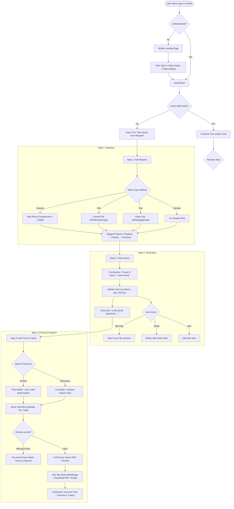

# QuoteCraft Mobile-First B2B UI/UX Audit (Phase 0)

## 1. Overview & Methodology
This audit evaluates QuoteCraft under real-world conditions experienced by ship chandlers, marine spare suppliers, and procurement officers across India, UAE, and Singapore. These users operate on mid-range Android smartphones (360–412px wide), slow 4G/3G connections, under severe time pressure, often working one-handed in busy shipyard or port environments.

### Device Test Matrix
- **360 × 800 px**: Samsung Galaxy A-series, Xiaomi Redmi (Standard budget Android, primary demographic)
- **390 × 844 px**: iPhone 12 / 13 / 14 / 15 (Standard iOS reference)
- **412 × 915 px**: Google Pixel 7 / Samsung Galaxy S21+ (Large Android reference)

### Automated Test Artifacts
- **24 automated screenshots** captured at 360px, 390px, and 412px viewports in `audit-screenshots/`.
- **DOM measurement dataset** in `audit-screenshots/audit-results.json`.

---

## 2. Findings Table

| Screen | Problem | User-Psychology Reason | Severity | Fix Idea |
| :--- | :--- | :--- | :--- | :--- |
| **Landing Page** | 15 tap targets under 44px (e.g. Hamburger menu 40×40, billing pills 40px, footer links 16px). | **Fitts's Law**: Small targets lead to missed taps and frustration when tapping with a thumb while walking. | High | Enforce `min-h-[44px] min-w-[44px]` touch padding on all interactive elements. |
| **Landing Page** | Pricing toggle button labels are dense and wrap awkwardly on 360px. | **Hick's Law / Cognitive Load**: Users need immediate clarity on pricing without squinting. | Medium | Stack billing toggle buttons vertically or convert to a native mobile tab switcher. |
| **Sign-In / Sign-Up** | Clerk form input heights are 40px with font size 14px; "Back to Home" is only 28px tall. | **iOS Auto-Zoom & Fitts**: Inputs under 16px trigger automatic viewport zoom on iOS, disrupting flow. | High | Set Clerk input styles to `min-h-[48px]` and `font-size: 16px`. Increase back link tap area to 44px. |
| **Global Navigation** | Mobile bottom nav has 5 items including "Tour", crowding 360px screens with labels as small as 10px. | **Miller's Law (7±2, max 4 on mobile)**: 5 items cause accidental taps and visual noise. | High | Restrict bottom navigation to exactly 4 items: **Home, Quotes, Templates, Settings**. |
| **Global Navigation** | Mobile bottom bar is hidden on `/`, leaving no easy exit hatch to return to Dashboard or Settings. | **Loss of Wayfinding**: Users feel trapped inside the quotation builder if they want to check past quotes. | High | Add a persistent top bar exit link / breadcrumb and support seamless modal or bottom bar transitions. |
| **Dashboard** | 4 desktop stat cards take up 55% of the mobile screen above the fold, pushing the recent quotes below view. | **Hick's Law / Time to First Value**: Chandlers want to see their active quotes or start a quote in < 5 seconds. | High | Collapse metrics into a compact single-row summary card; hide 0-value stats; place a giant primary button at the top. |
| **Dashboard** | Missing prominent "Continue your quote" draft resume card. | **Zeigarnik Effect**: Users get interrupted by phone calls or WhatsApp; without a resume card, unfinished work is forgotten. | Critical | Add an ambient, high-priority **"Continue your quote"** card if a local or saved draft exists. |
| **Step 1 (Add Request)** | 7+ metadata fields (Quote No., Vessel, Make, Model, Client, Address) shown upfront before uploading RFQ. | **Miller's Law / Cognitive Overload**: Forcing users to fill out metadata before extracting items delays time to value. | Critical | Move quote number, vessel, make, and customer info to **Step 3**. Step 1 must focus 100% on ingesting the request. |
| **Step 1 (Add Request)** | No direct "Take Photo" action with camera capture; no client-side image compression. | **Jakob's Law**: Chandlers frequently receive paper RFQs at ports. They expect to snap a photo and proceed. | Critical | Add dedicated `<input type="file" capture="environment" accept="image/*">` with browser canvas compression (< 1.5MB). |
| **Step 1 (Add Request)** | Generic loading spinner during AI extraction with no staged feedback or elapsed time. | **Need for Certainty**: Without staged progress, users assume the app froze on slow 4G and refresh the page. | High | Implement real staged progress: *"Reading file (1/3) → Finding items (2/3) → Checking details (3/3)"* with live elapsed timer. |
| **Step 2 (Check Items)** | No high-trust summary banner; user is forced to inspect every row without guidance. | **Loss Aversion / Fear of Mistakes**: Chandlers fear quoting wrong part numbers or quantities. | Critical | Add a clear top trust banner: *"We found 24 items. 3 need your check."* with a **"Next to check"** jump button. |
| **Step 2 (Check Items)** | Desktop table view is awkward on 360px; wide table columns cause pinch-zoom and horizontal drift. | **Fitts / Thumb Zone**: Wide tables are impossible to scan or tap reliably on a 360px screen. | Critical | Present items strictly as a **Card List** on mobile: Large item name, prominent Qty & Unit, part number badge, details under "More". |
| **Step 2 (Check Items)** | Deleting an item is instant with no immediate undo toast. | **Loss Aversion / Error Prevention**: Accidental thumb swipes or taps can delete critical items. | High | Provide swipe-to-delete with a persistent 5-second **Undo Toast**. |
| **Step 3 (Prices & Send)** | Entering prices in a wide list is tedious on a phone keyboard. | **Fitts / Thumb Ergonomics**: Tapping tiny price inputs opens alphanumeric keyboard repeatedly. | Critical | Introduce **"Price Mode"**: One item at a time with a huge numeric keypad (`inputmode="decimal"`), "Item 1 of 24", and Prev/Next buttons. |
| **Step 3 (Prices & Send)** | No pre-send validation check; easy to accidentally send a quote with missing prices. | **Error Prevention / Loss Aversion**: Sending a 0-price quote to a shipowner damages commercial reputation. | Critical | Add a **Pre-Send Check Sheet**: Alerts *"2 items have no price"*, blocks accidental export, and provides jump links. |
| **Step 3 (Prices & Send)** | Sticky summary bar covers content or gets obscured by Android navigation bar. | **Fitts's Law / Safe Area**: Primary CTA must be in the bottom 40% thumb zone and respect `env(safe-area-inset-bottom)`. | High | Standardize sticky `BottomActionBar` with `pb-[max(1rem,env(safe-area-inset-bottom))]` and backdrop blur. |
| **Quotes List** | List loads heavy JSON states; no search or status filter chips on mobile. | **Recognition over Recall**: Users need to quickly find quotes by vessel name or customer while on a call. | High | Add filter chips (*All, Draft, Sent, Won*) and a quick vessel/quote search bar. |
| **Settings** | Long monolithic form with company, bank, and tax details shown all at once. | **Progressive Disclosure**: Chandlers get overwhelmed by 15+ blank configuration fields on first login. | Medium | Group into collapsible sections (*Company, Look of Quotes, Standard Terms, Account*); request bank info only when needed. |

---

## 3. Specialized Deep Dive Checks

### A. Horizontal Scrolling
- **Status:** **PASS** on static pages (`scrollWidth === windowWidth === 360px`).
- **Risk:** Desktop table layouts inside Step 2 and Step 3 cause overflow when dynamically loaded if not wrapped in mobile card transformers.

### B. Typography & Font Sizing
- **Finding:** Several sub-labels, badge counts, and table headers utilize `text-xs` (11–12px).
- **Rule:** Body text must be $\ge 14\text{px}$, inputs must be $16\text{px}$ on mobile (prevents iOS viewport scaling), captions must be $\ge 12\text{px}$, and zero text below $12\text{px}$ is permitted anywhere.

### C. Touch Target Ergonomics (Fitts's Law)
- **Finding:** 15 interactive elements measured between 28px and 40px in height.
- **Rule:** Every touch target must be $\ge 44 \times 44\text{px}$ with at least 8px spacing between adjacent touch zones.

### D. Virtual Keyboard Handling & Input Mode
- **Finding:** Several numeric inputs currently omit `inputmode="decimal"`, which triggers full QWERTY keyboard popups on Android and iOS.
- **Rule:** All numeric pricing, quantity, discount, and tax inputs must explicitly declare `inputmode="decimal"` and `enterkeyhint="next"`.

### E. React Hooks & Architecture Sanity
- **Finding:** Evaluated `src/app/page.tsx`, `src/app/dashboard/page.tsx`, and flow components. All early returns (`if (!authLoaded)`) occur before child component invocation, preserving the Rules of Hooks.

---

## 4. Proposed Mobile Information Architecture (IA)

```
QuoteCraft Mobile App
│
├── Bottom Navigation (Max 4 items)
│   ├── [1] Home (Dashboard + Draft Resume + Giant "New Quote" CTA)
│   ├── [2] Quotes (Search, Status Filter Chips: Draft/Sent/Won/Lost)
│   ├── [3] Templates (Layout preview cards, Free vs Pro indicators)
│   └── [4] Settings (Accordion: Company, Appearance, Terms, Account)
│
└── 3-Step Core Quotation Flow (Full-Screen Ergonomics)
    ├── Step 1: Add Customer's Request
    │   ├── Primary CTAs: [Take Photo] [Choose File] [Paste Text] [Try Sample]
    │   ├── Client-side image compression (< 1.5MB)
    │   └── Staged Extraction Progress with live timer & fallback
    │
    ├── Step 2: Check Items (Trust Builder)
    │   ├── Trust Banner: "We found 24 items. 3 need check." + [Jump to Check]
    │   ├── Mobile Card List (Item Name, Qty/Unit badge, Part No., More details)
    │   ├── Uncertainty Flags (Amber highlight + reason + "See in file")
    │   ├── Swipe-to-delete with 5-second Undo Toast
    │   └── Sticky Bottom Bar: "Looks good, add prices →"
    │
    └── Step 3: Add Prices and Send
        ├── Mode Switcher: [Price Mode (1-by-1)] | [List Mode]
        ├── Price Mode: Big numeric keypad, "Item X of Y", Prev / Next
        ├── Quotation Commercials: Discount, Tax with (?) help sheet, Shipping
        ├── Auto-filled Document Info (Quote No., Vessel, Customer)
        ├── Advanced Accordion: Column Customization
        ├── Pre-Send Validation Sheet ("2 items unpriced" blocker)
        ├── Full-Screen Vector PDF Preview with pinch-zoom
        └── Share Deck: [Share on WhatsApp] [Download PDF] [Copy Link]
```

---

## 5. Mobile Flow Diagram



---

## 6. Feature Flag Rollout Specification
To ensure zero regression for existing desktop users and allow instant rollback:
- **Flag Variable:** `NEXT_PUBLIC_NEW_MOBILE_UI=true`
- **Fallback Behavior:** If `process.env.NEXT_PUBLIC_NEW_MOBILE_UI !== "true"`, the application renders the existing classic desktop/hybrid layout with 100% feature parity.

